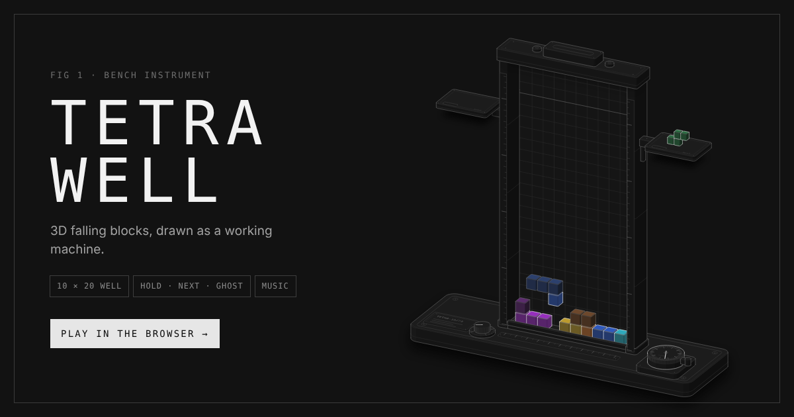
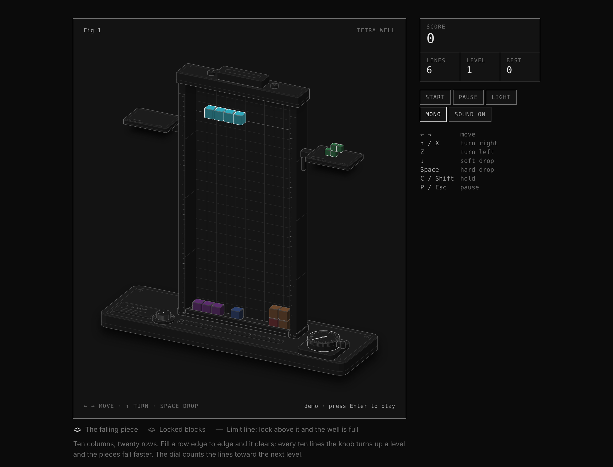

# Tetra Well — 3D falling blocks

A falling-block puzzle drawn as an isometric bench instrument. It was built with the
[Anatomy](https://github.com/wheresryan22/anatomy) skill: the well stands between two
ruled posts on a base plate. A hopper on the top beam feeds the pieces, a hold tray and
a next tray sit on brackets, a dial counts the lines toward the next level, and a knob
shows the level. Every block is a kit solid with four-tone shading, painted back to
front in true depth order.





## Play

Open `index.html` in any browser. It is a single self-contained file with no
dependencies.

| Key | Action |
|---|---|
| ← → (A D) | move |
| ↑ / X (W) | turn right |
| Z / Ctrl | turn left |
| ↓ (S) | soft drop |
| Space | hard drop |
| C / Shift | hold |
| P / Esc | pause |
| M | music on / off |
| Enter | start / restart |

On touch screens, drag sideways to move, tap to turn and flick down to drop. An
on-screen pad also appears.

- SRS rotation with wall kicks, a 7-bag randomiser, hold, a ghost piece, and a lock delay that resets when you move.
- Scoring: 100 / 300 / 500 / 800 × level for 1–4 lines, plus 1 point per row of soft drop and 2 per row of hard drop. Every 10 lines raises the level.
- An attract mode where a small planner plays while nobody is playing.
- Background music: an original 8-bar loop in A minor, synthesized live with WebAudio (no audio files). It plays only during a game, pauses with the game and speeds up a little with each level.
- Light and dark themes, an optional colour mode (one hue per piece), sound, and a best score saved locally.
- Honours `prefers-reduced-motion`.

## Build

```bash
node build.mjs
```

`build.mjs` builds the static drawing with `kit/iso-kit.mjs` (the Anatomy kit, MIT, see
`kit/LICENSE-anatomy`). It then inlines the kit and `src/game.js` into `index.html`.

## Link banner

`docs/banner.png` (1200×630) is the preview image for links. `index.html` carries Open Graph and
Twitter tags that point to it. They assume the page is published with GitHub Pages at
`https://qazaqboss.github.io/tetris-3D/`; to use another address, rebuild with
`SITE_URL=https://your.site/path/ node build.mjs`.
